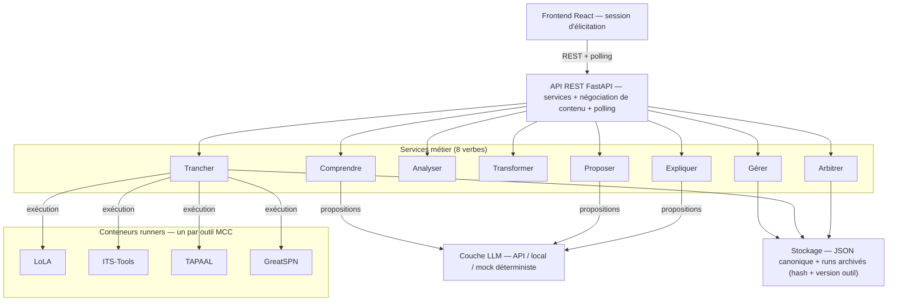
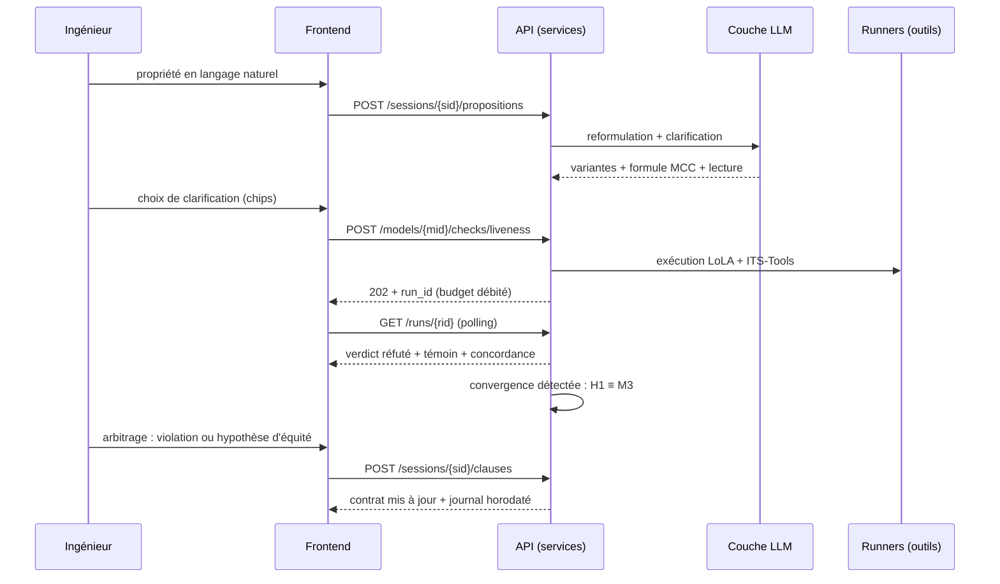

# Petrichor — Conception complète de l'application

*Assistance IA à l'élicitation et à la vérification formelle de réseaux de Petri (P/T, Symmetric) — prototype de recherche.*

**Identité.** Le nom **Petrichor** désigne l'odeur de la terre sèche au premier contact de la pluie : ce qui devient perceptible juste avant de se révéler — exactement le produit, des propriétés invisibles rendues sensibles avant d'être prouvées. Le mot contient « Petri ». Tagline : *« L'IA propose, l'ingénieur arbitre, les outils tranchent. »* Aucun outil de vérification formelle ne porte ce nom.

Document de référence v1.2 · Base : architecture API v2 actée + maquette d'élicitation Philosophes-3 (toutes ses fonctions sont reprises ci-dessous comme exigences frontend) + spécifications détaillées (format canonique, moteur d'élicitation, contrat LLM, témoins, capacité des outils MCC, protocole d'implémentation).

---

## 1. Objet, périmètre, principes

**But.** Aider un ingénieur à produire un *contrat de vérification* complet et traçable pour un réseau de Petri : l'IA génère des questions candidates, l'ingénieur arbitre, les outils du Model Checking Contest tranchent. Chaque clause du contrat final est reliée à un run d'outil archivé.

**Principes non négociables.**

1. **« L'IA propose, les outils disposent. »** Aucune couche IA n'émet de verdict sémantique. Toute affirmation devient une question formelle posée à un outil. Le seul émetteur de verdicts est le service *Trancher* (exécution d'outils).
2. **Pas de conversion IA entre formalismes.** L'IA travaille dans le formalisme d'origine. Les quasi-symétries détectées sont des *smells* → questions d'élicitation, jamais une recolorisation automatique P/T → Symmetric.
3. **Modèles read-only.** L'application n'édite pas le réseau. Les transformations produisent des *modèles dérivés* avec lignage et certificat, jamais une mutation en place.
4. **Traçabilité intégrale.** Chaque clause porte : sa provenance (patron guideword × rôle, ou proposition humaine), son arbitrage humain horodaté, son run d'outil (verdict, coût, version d'outil), et le statut du compte-rendu.
5. **Périmètre initial** : P/T + Symmetric nets, dès le départ. Couche LLM abstraite (API / local / **mock déterministe** pour tests et reproductibilité). Objectif : prototype de recherche + publication ; priorité au module d'élicitation ingénieur (M6).

**Non-objectifs assumés.** Pas de chat libre permanent (il court-circuite le triage et le budget) ; pas d'éditeur de réseau ; pas de multi-utilisateur temps réel dans le prototype.

---

## 2. Vue d'ensemble



**Règle structurante : les services s'échangent des identifiants, jamais du contenu.** `question_id`, `run_id`, `model_id` circulent entre eux ; le contenu (formules, marquages, traces) est résolu au niveau de la ressource concernée. Un service ne réutilise jamais la sortie brute d'un autre : il la redemande au stockage ou à l'outil.

---

## 3. Socle technique (acté)

| Brique | Choix | Justification |
|---|---|---|
| Backend | **Python + FastAPI** | Écosystème Petri/outils, validation Pydantic, async pour le polling |
| Frontend | **React + TypeScript (Vite)** | Suite directe de la maquette |
| Outils | Conteneurs **runners** (LoLA, ITS-Tools, TAPAAL, GreatSPN) | Un conteneur par outil, adaptateur de dialecte embarqué dans le conteneur |
| LLM | Couche d'abstraction `LLMProvider` | Implémentations : `MistralAPIProvider`, `LocalProvider` (vLLM/Ollama), `DeterministicMockProvider` |
| Stockage | **JSON canonique = vérité** ; PNML = interop | ids d'éléments stables, `layout` et `annotations` de première classe |
| Auth | Clé API simple (`X-API-Key`) | Prototype mono-utilisateur ; pas d'OAuth |

Le **mock déterministe** est un citoyen de première classe : les sorties LLM du prototype (profils sémantiques, lectures naturelles, clusters) sont scriptées dans des *golden files*, ce qui rend les expériences reproductibles — exigence pour la publication (étude C, benchmark par injection de fautes).

---

## 4. Les huit services

### 4.1 Gérer — modèles et sessions

Responsabilités : import PNML → JSON canonique (ids stables, `layout`, `annotations`), idempotence par **hachage de contenu**, lignage first-class, sessions d'élicitation.

- `POST /v1/models` — corps `application/pnml+xml` → `application/petri+json; version=1.0`. **201** si nouveau, **200** si le hachage existe déjà (même modèle rendu). *Pas de batch-import* : un script client pousse les modèles du benchmark un par un.
- `GET /v1/models/{mid}` — négociation : `petri+json` (canonique) ou `pnml+xml` (ré-export interop).
- `GET /v1/models/{mid}/lineage` — `parent`, `children`, `derivations`, `certificates`.
- `POST /v1/sessions` `{ "model_id": "…" }` → session d'élicitation (contrat vide, budget alloué).
- `GET /v1/sessions/{sid}` — état complet (questions, arbitrages, contrat, budget, journal) → **reprise de session**.

### 4.2 Comprendre — profil sémantique

Responsabilités : extraction des rôles (état d'automate, détention, section critique, ressource, flux), confiances, preuves ; **corrections humaines in situ** (cliquer une place du graphe et corriger son rôle) ; quasi-symétries signalées comme smells.

- `POST /v1/models/{mid}/semantic-profile` — extraction LLM → rôles + confiances + preuves + smells. Sortie validée par JSON schema ; *toujours* étiquetée « hypothèse sémantique », jamais verdict.
- `PATCH /v1/models/{mid}/semantic-profile` — correction humaine d'un rôle : tracée comme réponse humaine, horodatée au journal ; les rôles corrigés guident la génération de questions.

### 4.3 Analyser — analyses structurelles/statiques (gratuites)

Responsabilités : tout ce qui se tranche *sans exploration d'états* : invariants de places, conservation, mutex statique, bornage. **Un endpoint par analyse** (pas de dispatch polymorphe) ; chaque résultat est une vue fine **mise en cache** (clé = hachage de contenu + version d'outil).

- `POST /v1/models/{mid}/analyses/invariants` → 202 + `run_id`
- `POST /v1/models/{mid}/analyses/structural` — conservations, producteurs/consommateurs, flux imposés
- `POST /v1/models/{mid}/analyses/symmetry-smells` — quasi-symétries → questions d'élicitation (jamais recolorisation)

### 4.4 Transformer — modèles dérivés à préservation vérifiée

Responsabilités : transformations (ex. dépliage Symmetric → P/T pour un outil donné, réductions). Sortie = **modèle dérivé** (enfant dans le lignage) + **certificat de préservation vérifié par un outil** (pas par l'IA) + `element_map` obligatoire. Échec de vérification → pas de modèle dérivé, erreur explicite.

- `POST /v1/models/{mid}/transformations/{name}` — ex. `unfold-symmetric`, `stubborn-reduction` → 202 + `run_id` ; à terme `derived_model_id` + certificat.

### 4.5 Proposer — questions candidates et propositions humaines

Responsabilités : générer les questions par la grille **rôles sémantiques × mots-guides** (No/More/Less/Early/Late/Reverse/As well as) ; triage **statique vs MC** ; risque × coût ; non-vacuité attachée à chaque question ; boucle de formalisation des propositions humaines en langage naturel (reformulation → chips de clarification → formule MCC) ; **détection de convergence** (une proposition ≡ une question déjà arbitrée → fusion).

- `POST /v1/sessions/{sid}/question-sets` — instancie la grille guidewords × rôles → questions candidates statiques + MC (fil rouge : 17 questions → 9 statiques + 8 MC).
- `GET /v1/sessions/{sid}/questions` — catalogue avec triage, risque×coût, vacuité, provenance.
- `POST /v1/sessions/{sid}/propositions` — proposition humaine NL → boucle de clarification (LLM) → formule + lecture + non-vacuité + estimation de triage. Pas de faux verdict : ce qui n'est pas scriptable part en file de vérification asynchrone.

### 4.6 Trancher — exécution d'outils (seul émetteur de verdicts)

Responsabilités : exécuter une question formelle sur les outils, **contre-vérification croisée inter-outils** (2 outils par défaut, concordance signalée), budget, coûts, witnesses. Un endpoint par famille de propriété ; la formule est dans le corps.

- `POST /v1/models/{mid}/checks/reachability` — `EF φ`
- `POST /v1/models/{mid}/checks/safety` — `AG ¬φ`
- `POST /v1/models/{mid}/checks/liveness` — `AG AF φ` (+ paramètre d'équité faible/forte)
- `POST /v1/models/{mid}/checks/recovery` — `AG EF φ`
- `POST /v1/models/{mid}/checks/deadlock` — `EF DEADLOCK`
- `GET /v1/runs/{rid}` — polling : `queued → running → done | failed` ; verdict par outil + **concordance**, coût, witness.

**Runs partagés** : clé de cache = hachage de contenu + formule + versions d'outils. Une même propriété revérifiée (par une autre session, ou après révision d'un arbitrage) **relance un run facturé** — sauf si la clé existe déjà (gratuit). Le budget cumulé de session est incrémenté par run.

### 4.7 Expliquer — traduction inverse, lectures, témoins

Responsabilités : lecture naturelle de chaque formule + encart « **ce qu'elle ne dit pas** » (l'audit de la traduction fait partie de la traduction) ; traces rejouables pas à pas (états actifs, transition tirée, narration) ; clustering des témoins → causes racines **Modèle vs Spécification**. Tout ce qui sort de cette couche est une *proposition* LLM, étiquetée comme telle.

- `POST /v1/readings` `{ "formula": "AG AF (eat_1)" }` → lecture + ne-dit-pas + pattern (sosies EF / AG EF / AG AF).
- `GET /v1/runs/{rid}/witness` — trace pas à pas (marquages, transition tirée, narration).
- `POST /v1/sessions/{sid}/witness-clusters` — clustering des témoins des violations → clusters avec cause (défaut du modèle / hypothèse de spécification manquante) et remédiation.

### 4.8 Arbitrer — le contrat d'élicitation

Responsabilités : enregistrer les arbitrages humains (« Impossible » / « C'est normal » / « Vérifier d'abord », puis classement en clause ou hypothèse), **révisabilité** des arbitrages (l'ancienne décision reste au journal), fusions de convergence, journal horodaté, contrat 3 volets, export.

- `POST /v1/sessions/{sid}/arbitration-requests` `{ "question_id": "M3", "decision": "verify-first" }`
- `POST /v1/sessions/{sid}/clauses` — clause (volet `never` | `always` | `hypo`, texte, `run_id`, provenance, cluster)
- `POST /v1/sessions/{sid}/clauses/{cid}/revisions` — révision : clause remplacée, décision précédente conservée au journal ; une révision peut relancer un run (facturé).
- `POST /v1/sessions/{sid}/convergences` `{ "question_id": "M3", "proposition_id": "H1" }` — fusion : la question est marquée couverte, plus jamais resolicité.
- `GET /v1/sessions/{sid}/journal` — timeline horodatée (arbitrages, runs, révisions, fusions) — exigence d'audit.
- `GET /v1/sessions/{sid}/contract` — négociation : `application/contract+json; version=1.0` (volets, violations, clusters, dossiers de preuve) ou `text/markdown` (export du livrable).

---

## 5. Contrat d'API transverse

**Négociation de contenu** par en-têtes, médias types versionnés :

| Média type | Usage |
|---|---|
| `application/petri+json; version=1.0` | Modèle canonique (vérité) |
| `application/pnml+xml` | Import / ré-export interop |
| `application/semantic-profile+json; version=1.0` | Profil sémantique |
| `application/contract+json; version=1.0` | Contrat |
| `application/problem+json` | Erreurs (RFC 7807) |

**Asynchronisme : polling uniquement** (pas de webhooks dans le prototype). Toute exécution : `202 Accepted` + `Location: /v1/runs/{rid}` ; le client interroge `GET /v1/runs/{rid}` jusqu'à `done | failed`.

**Erreurs.** `401` clé API ; `406/415` négociation impossible ; `404` ressource ; `409` budget de session épuisé (avec budget consommé dans le corps) ; `422` formule mal formée ; `500` runner. Toujours `problem+json`, avec `tool`, `run_id`, `budget` dans `extensions`.

**Idempotence.** Modèles : hachage de contenu. Runs : clé = hachage + formule + versions d'outils. Un `POST` rejoué avec la même clé renvoie le run existant sans refacturer.

**Budget.** Alloué par session ; chaque run porte son coût (temps outil, états explorés) ; le budget cumulé est visible partout (frontend, contract, journal). Questions statiques : gratuit.

---

## 6. Ressources principales (niveau conceptuel)

- **Model** : `id`, `formalism` (`pt` | `symmetric`), `content_hash`, éléments à ids stables, `layout`, `annotations`, `parent`, `children`, `derivations[]`, `certificates[]`.
- **Session** : `id`, `model_id`, contrat courant, budget alloué/consommé, état des questions, journal.
- **Question** : `id`, `origin` (`grid` | `human`), `guideword`, `element`, `formula`, `pattern`, `vacuity`, `triage` (`static` | `mc`), `risk`, `cost`, `status` (`open` | `answered` | `covered`).
- **Run** : `id`, `tools[]` (avec version), `verdicts[]` + `concordance`, `cost`, `witness_ref`, `log_ref`, `derived_model_id?` (transformations).
- **Clause** : `id`, `volet` (`never` | `always` | `hypo`), `texte`, `status` (`proved` | `refuted` | `hypothesis`), `run_id`, `source` (provenance), `cluster?`.
- **Witness** : états actifs pas à pas, transition tirée, narration, cyclicité.
- **Journal** : entrées horodatées `{ ts, acteur (humain | outil | système), label, refs }`.

---

## 7. Adaptateurs outils & dialectes

Chaque runner embarque son **adaptateur de dialecte** : la couche services ne connaît jamais la syntaxe propriétaire d'un outil. L'adaptateur traduit question formelle → dialecte (propriété MCC du concours), et sortie brute → vue fine normalisée (verdict, witness, coût).

- **Contre-vérification croisée** : défaut = 2 outils par run MC (ex. Tapaal + ITS-Tools), concordance exposée ; divergence = signal fort remonté à l'ingénieur. Appariement détaillé par famille au §17.
- **Reproductibilité publication** : chaque run archive commande, version d'outil, timeout, hachage d'entrée. Les runs sont des *données d'expérience* — pas purgés silencieusement.
- **Certificats de transformation** : préservation vérifiée par l'outil, `element_map` obligatoire ; sans certificat, pas de modèle dérivé.

---

## 8. Couche LLM

`LLMProvider` (interface unique) : `MistralAPIProvider`, `LocalProvider`, `DeterministicMockProvider` (golden files issus du corpus de la maquette). Règles :

- **Sorties typées** : chaque appel LLM vise un JSON schema (rôles, lecture, cluster…). Échec de validation → re-demande bornée, puis dégradation explicite, jamais de verdict inventé.
- **Température 0** par défaut ; toute sortie est étiquetée `provenance: llm` et présentée comme *proposition* ou *hypothèse sémantique*.
- Usages : extraction du profil sémantique, reformulation/clarification des propositions, lectures naturelles et « ne dit pas », narration des témoins, clustering. Interdits : verdicts, conversions de formalisme, éditions du modèle.

---

## 9. Frontend (React)

La maquette d'élicitation devient la **spécification UI de référence**. L'application reprend intégralement :

- **Parcours en 4 étapes** : Amorçage (profil sémantique, corrections in situ sur le graphe) → Questions statiques → Vérifications MC → Synthèse.
- **Cartes-question** : 3 réponses (Impossible / C'est normal / Vérifier d'abord), triage statique gratuit vs MC risque×coût, chip non-vacuité, contre-vérification inter-outils affichée, formule repliée avec lecture + « ne dit pas » + provenance, **formule éditable en mode avancé** avec re-lecture inverse automatique et mise en file de re-vérification.
- **Vue du réseau permanente** : P/T complet (places, transitions rectangulaires, arcs fléchés, transition tirée surlignée dans les témoins), overlay de couverture (éléments non contraints grisés), surbrillance des éléments d'une question au survol, amorçage in situ (cliquer une place/transition → rôle + confiance + correction).
- **Boucle de propositions humaines** : langage naturel → clarification par chips → formule MCC → vérification → verdict → arbitrage ; convergence avec les questions existantes (fusion, marquage « couverte », aucune double sollicitation).
- **Contrat 3 volets** (ne doit jamais arriver / doit arriver / hypothèses explicites) avec **dossiers de preuve** cliquables (formule, run, coût, statut), **export Markdown** du livrable, diagnostic par clusters (Modèle vs Spécification).
- **Révisabilité** de chaque arbitrage + **journal horodaté** latéral ; **budget MC cumulé** ; **session reprenable** ; accessibilité (aria, focus visible, lecteurs de témoins au clavier).

**Architecture front.** React + TypeScript + Vite ; client REST typé avec hook de polling générique (`202 + Location` → polling → notification) ; état serveur = source de vérité (`GET /sessions/{sid}`), état local optimiste pour l'UI ; rendu SVG du réseau **piloté par le layout canonique** (le composant NetView de la maquette devient le moteur de rendu générique).

---

## 10. Flux de bout en bout — proposition humaine (fil rouge)



Cas fil rouge Philosophes-3 : « Un philosophe qui a faim finira toujours par manger » → `AG AF (eat_1)` → réfuté sans équité (témoin : cycle du philosophe 2) → convergence avec M3 → l'ingénieur tranche *hypothèse d'équité forte* → cluster B « hypothèse de spécification manquante », pas un bug du modèle.

---

## 11. Feuille de route (actée)

| Phase | Contenu | Jalon |
|---|---|---|
| **0** | Socle : conteneurs runners, adaptateurs dialectes, `POST /models` + hachage, mock LLM déterministe | Importer Philosophes-3, exécuter `EF DEADLOCK` via un moteur réel (premier adaptateur qualifié, cf. §17) et lire le run |
| **1** | MVP : profil sémantique + questions statiques + élicitation minimale (amorçage, cartes, contrat, journal) | Session d'élicitation complète sans exploration d'états |
| **2** | Chaîne MC complète : checks par famille, contre-vérification croisée, témoins rejouables, budget, propositions humaines, convergence, export | La maquette, branchée sur de vrais verdicts |
| **3** | Étude pilote (protocole §20) | 1 modèle réel, contrat complet, mesure du coût cumulé |
| **4** | Études A–D (protocole §20), dont **C** : benchmark par injection de fautes (classe « asymétrisation ») | Publication |

---

## 12. Décisions actées (revue des points chauds)

1. **Granularité des checks : par famille.** Endpoints `/checks/{famille}` (reachability, safety, liveness, recovery, deadlock) ; les patterns précis sont des schémas de corps typés dans la famille. Raison : le triage, l'appariement inter-outils de la contre-vérification et la stabilité de l'API vivent au niveau famille ; la clé de cache contient déjà la formule exacte, rien à gagner à descendre. Garde anti-polymorphisme : un endpoint ne change jamais de sémantique selon son corps — pattern hors famille = `422`, jamais réinterprété.
2. **Convergence : asymétrique.** *Proposer* détecte à la génération (alerte précoce « cette question existe déjà, arbitrez-la une fois ») ; *Arbitrer* seul fusionne (statut `covered`, retrait de sollicitation) — c'est une décision d'état du contrat.
3. **Équité : statut à part.** Une hypothèse d'équité est à la fois documentée dans le volet hypothèses *et* consommée comme paramètre des runs de vivacité — clause liée au run qu'elle répare (`repairs_run_id`).
4. **Coût : temps outil consommé.** Unité MCC ; plafond par session configurable ; pas de report de budget. Les états explorés sont archivés comme métadonnée, pas comme monnaie.
5. **Rétention : archivage intégral des runs.** Le couple (modèle, run) est la donnée d'expérience de l'étude C — le budget limite ce qu'on produit, jamais ce qu'on garde.
6. **Symmetric : import dès la phase 0, dépliage en phase 2.** Le canonique accepte les deux formalismes dès le socle (schéma de données non menteur) ; les transformations avec certificats n'arrivent qu'avec la chaîne MC.
7. **Révisions : propagation.** Réviser l'arbitrage d'une question rouvre aussi les clauses des questions couvertes par convergence avec elle ; le journal conserve l'intégralité des décisions (ancienne et nouvelle).

---

## 13. Le format canonique `petri+json` (version 1.0)

La vérité de stockage. Trois invariants de conception : **ids stables** (jamais réutilisés, jamais réordonnés — le lignage et les `element_map` en dépendent), **layout et annotations de première classe** (le graphe se redessine sans perte, la sémantique se discute dessus), **hachage sémantique séparé du contenu brut** (déplacer un nœud ou renommer une place ne crée pas un nouveau modèle).

```json
{
  "id": "mdl_8f3ac1",
  "formalism": "pt",
  "content_hash": "sha256:9a41…",
  "parent": null,
  "children": [],
  "derivations": [],
  "places": [
    { "id": "pl_011", "name": "think_1", "initial_marking": 1,
      "layout": { "x": 320, "y": 78 },
      "annotations": { "role_hint": "automaton-state", "comments": [] } }
  ],
  "transitions": [
    { "id": "tr_004", "name": "takeL_1",
      "layout": { "x": 254, "y": 102 },
      "annotations": { "role_hint": "acquisition", "silent": false } }
  ],
  "arcs": [
    { "id": "ar_031", "source": "pl_011", "target": "tr_004", "weight": 1, "annotations": {} }
  ],
  "color_domain": null,
  "metadata": { "source": "pnml", "imported_at": "2026-11-02T12:00:00Z" }
}
```

Pour un Symmetric net, s'ajoute `color_domain` (classes de couleurs, domaines) et les places portent leurs classes de couleurs — même squelette, le hachage couvre les deux formalismes.

**Règles de hachage.**

- **Hachage canonique** (idempotence de l'import, `POST /models`) : sérialisation déterministe (clés triées, éléments triés structurellement) de la partie *sémantique* uniquement — structure, marquage initial, poids d'arcs. **Exclu** : ids, layout, annotations, metadata. Deux PNML cosmétiquement différents peuvent partager le hachage → même modèle rendu.
- **Clé de cache des runs** : hachage canonique + formule normalisée + versions d'outils.
- **Annotations hors modèle** : `role_hint` est une suggestion écrite par *Comprendre* ; les corrections humaines vont dans le profil sémantique (ressource dédiée), jamais dans le modèle — read-only acté.

## 14. Le moteur d'élicitation — spécification métier

Le cœur du produit : transformer un profil sémantique en questions vérifiables, triées, priorisées et non redondantes. C'est ici que vit l'originalité de Petrichor ; le reste est de l'ingénierie autour.

### 14.1 Le catalogue de génération (rôles × mots-guides)

Chaque couple productif = un **template** : texte de scénario paramétré par les éléments du rôle, pattern (`famille.kind`), triage, risque et coût de base. Les couples non productifs sont **documentés comme tels** — le silence de génération est interdit (on sait toujours pourquoi on ne demande pas).

| Rôle (profil) | Mot-guid | Scénario type | Pattern (`famille.kind`) | Triage |
|---|---|---|---|---|
| ressource partagée | More | double détention | `safety.invariant` | statique |
| ressource partagée | As well as | perte / duplication | `safety.conservation` | statique |
| ressource partagée | No | captive à jamais | `recovery.unconditional` | MC |
| état d'automate | More | états simultanés | `safety.state_invariant` | statique |
| section critique | No | gel en section critique | `liveness.conditional` | MC |
| détention intermédiaire | Less | geste commencé, jamais fini | `liveness.conditional_disj` | MC |
| motif global | No | impasse totale | `deadlock` | MC |
| motif global | Late | famine sous vivacité globale | `liveness.unconditional` | MC |
| acquisition | Early | ordre d'acquisition inversé | `structural.precondition` | statique |
| libération | Early | restitution anticipée | `structural.producer` | statique |
| flux critique | Reverse | chemin court-circuité | `structural.unique_producer` | statique |

Sur Philosophes-3, la grille produit **17 candidats** (9 statiques + 8 MC) ; la maquette en détaillait 11. Les quasi-symétries (smells) s'ajoutent comme **questions d'élicitation** (« ce P/T est presque symétrique — le formalisme Symmetric serait-il plus fidèle ? ») — jamais une recolorisation.

### 14.2 Règle de triage statique vs MC

Une question est **statique** si elle se réduit à l'un des trois décibles sans exploration : (i) invariant linéaire (P/T-invariants), (ii) équation d'état / conservation, (iii) propriété structurelle locale (précondition, producteur unique). Sinon MC.

**Dégradation explicite, jamais de verdict implicite** : si la preuve statique échoue (aucun invariant trouvé en temps borné, structure non concluante), la question est **déclassée MC** avec le motif « preuve statique non trouvée ». L'échec d'une heuristique n'est jamais interprété comme un verdict.

### 14.3 Risque × coût et ordonnancement

- **Risque** = base du template (1–5), modulée par : confiance du rôle (un rôle corrigé par l'humain monte la priorité), gravité métier (section critique > attente), smell associé.
- **Coût** = base du pattern : statique 0 ; `EF` et `AG EF` 1 ; `AG (φ → AF ψ)` 2 ; `AG AF φ` 3 (peut exiger un second run paramétré équité).
- **Ordre de sollicitation** : risque décroissant, puis coût croissant ; sous budget restant — une question au-delà du budget reste en file, visible et expliquée.

### 14.4 Non-vacuité

Chaque question de vivacité/récurrence porte un **garde d'atteignabilité** (`EF φ`) ; chaque sûreté porte le garde `EF (risque)`. Garde satisfait → chip ✔ ; sans objet → chip discret ; **garde muet → ✗ et priorité clarification** : aucun verdict n'est rendu sur une propriété muette (« ne dit rien de ce modèle »). Le garde est un run distinct, mis en cache comme les autres.

### 14.5 Convergence — règle d'équivalence

Deux questions convergent si : même `famille.kind`, mêmes cibles **à substitution près des indices de symétrie** (sous symétrie vérifiée d'ordre 3, `eat_1 ≡ eat_2 ≡ eat_3`), ou formule identique après normalisation. *Proposer* émet un `convergence_hint` dès la génération (« cette question existe déjà, arbitrez-la une fois ») ; *Arbitrer* seul fusionne (statut `covered`, jamais resolicitée). La révision d'un arbitrage propage aux questions couvertes (acté).

### 14.6 Couverture — et sa contre-réaction

Les **groupes de couverture** dérivent du profil sémantique : un sous-rôle par groupe (réflexion, détention, repas, ressource, acquisition gauche, acquisition droite, libération). Un groupe est couvert par toute question arbitrée qui le mentionne (`cover`). La couverture n'est pas qu'un affichage : **les groupes non couverts re-sement la grille** — le générateur cible d'abord les trous, la complétude est un objectif piloté, pas une conséquence fortuite.

### 14.7 Équité — mécanisme du statut à part (acté)

- Chaque check de vivacité accepte `fairness: none | weak | strong` — un jeu de paramètres = un run distinct, facturé comme tel.
- Le **diagnostic différentiel** est un couple de runs : réfuté sans équité + prouvé sous équité forte ⇒ le défaut est une **hypothèse de spécification manquante**, pas un bug du modèle (cluster « Spécification »).
- La clause d'hypothèse d'équité porte `repairs_run_id` : le lien « cette clause répare ce run » est une donnée du contrat, consultable depuis le dossier de preuve.

## 15. Contrat LLM — schémas de sortie & golden files

Quatre usages, quatre sorties typées (validées par schéma, température 0, **2 tentatives max puis dégradation explicite** — jamais d'invention) :

| Usage | Sortie typée | Champs |
|---|---|---|
| `semantic-profile` | rôles + confiances + preuves + smells | `{ role, conf, evidence, options? }` |
| `reading` | lecture + ne-dit-pas + pattern + croisement | `{ reading, not_says, pattern, cross }` |
| `clarification` | reformulation + options (chips) | `{ reform, options[] }` |
| `cluster` | groupes + cause + remédiation | `{ cause: "model" \| "specification", fix, members[] }` |

**Golden files** (mock déterministe) : `golden/{model_hash}/{usage}.json` — le corpus initial est le contenu scripté de la maquette (profil Philosophes-3 avec son rôle volontairement faux, lectures des 7 formules du catalogue, clusters A/B). Le mock les sert tels quels ; ils servent de tests de non-régression du prompt engineering et de garantie de reproductibilité pour l'étude C.

## 16. Format des témoins & narration

```json
{
  "run_id": "run_7c2",
  "kind": "counterexample",
  "cyclic": false,
  "back_edge": null,
  "steps": [
    { "index": 0, "marking": ["think_1","think_2","think_3","fork_1","fork_2","fork_3"], "fired": null },
    { "index": 1, "marking": ["hasL_1","think_2","think_3","fork_2","fork_3"], "fired": "takeL_1" }
  ]
}
```

- **Structure = outil** (marquages, tirs, cyclicité, back-edge) ; **narration = proposition LLM** (une phrase par étape, étiquetée `provenance: llm`, jamais un verdict).
- Le lecteur pas-à-pas du front (transition tirée surlignée — déjà dans la maquette) consomme ce format tel quel.
- Un témoin partagé par plusieurs violations (clustering) est **stocké une fois, référencé n fois**.

## 17. Capacité des outils & association aux endpoints

Recherche menée sur le MCC (éditions 2024–2026). Les sites du concours bloquent l'accès automatique ; la synthèse s'appuie sur les pages de résultats, les annonces des équipes outils, les dépôts d'intégration MCC et le papier de référence (Amat et al., *Behind the Scene of the Model Checking Contest*, TOOLympics 2023, LNCS 14550). Cette section affine le §7 : **qui sait vérifier quoi, dans quel dialecte**, et fixe l'appariement de contre-vérification. Les capacités ci-dessous restent à recouper en phase 0 contre les exécutables réels.

### 17.1 Catégories d'examinations MCC (set 2025–2026)

| Catégorie MCC | Contenu | Production |
|---|---|---|
| StateSpace | construction du graphe des marquages (taille, profondeur) | statistiques |
| GlobalProperties | ReachabilityDeadlock, QuasiLiveness, StableMarking, Liveness, OneSafe | booléens |
| UpperBounds | borne du nombre d'états atteignables | entier |
| ReachabilityCardinality | `EF` d'une formule sur cardinalités de places | booléen |
| ReachabilityFireability | `EF` d'une formule de fireability (`FIREABLE t`) | booléen |
| CTLCardinality / CTLFireability | formules CTL (`AG`, `EF`, `AF`, `AU`…) à atomes cardinalité / fireability | booléen |
| LTLCardinality / LTLFireability | formules LTL (`G`, `F`, `U`, `R`…) à atomes cardinalité / fireability | booléen |

Notes historiques : variantes `*Simple`/`*Sim` (2015) ; le deadlock a été une catégorie dédiée (2019) puis regroupé dans GlobalProperties. Chaque examen MCC est distribué avec **résultat attendu** dans le XML — matière première de nos tests de conformance (§17.5).

### 17.2 Outils : couverture par catégorie (MCC 2026)

| Outil | Origine | Catégories 2026 | Technique dominante | Nets colorés | Rôle Petrichor |
|---|---|---|---|---|---|
| ITS-Tools | Y. Thierry-Mieg, LIP6 | toutes | symbolique SDD/DDD + réductions structurelles (y.c. LTL sensible au stutter) ; embarque LTSMin et Spot | oui | socle polyvalent, candidat par défaut toutes familles |
| Tapaal (verifypn) | J. Srba, Aalborg | GlobalProperties, UpperBounds, Reachability, CTL, LTL | explicite + réductions structurelles, untangling pour CTL, POR guidée par automates pour LTL ; or Reachability + CTL + LTL en MCC'24 **et** MCC'25 (badge 100 % de confiance) | oui | référence explicite, producteur de témoins |
| TY | A. Yates, Ferrite Technology | StateSpace, GlobalProperties, UpperBounds, Reachability, CTL, LTL | à documenter (outil nouveau 2026) | oui | 2ᵉ contre-vérificateur une fois qualifié phase 0 |
| smpt | N. Amat, ONERA | ReachabilityCardinality / Fireability | SMT, abstraction polyhédrique, témoins SMT | oui (pas encore dans l'image) | différentiel technologique sur la reachabilité |
| tedd | B. Berthomieu, LAAS | StateSpace | génération rapide de graphe | oui | non retenu (aucun verdict) |
| petrivet | M. Dyer, TUM | StateSpace, GlobalProperties | séquentiel, mono-cœur | non (P/T) | base de comparaison GlobalProperties |

Participants historiques non inscrits en 2026 (intégrables comme moteurs « hors MCC », à confirmer au cas par cas) : **LoLA 2** (LTL/CTL, patterns natifs `AGEF`, `GF`, `FG` — le spécialiste LTL historique), **GreatSPN** (MDD/saturation ; LTL et CTL* via starMC depuis 2020), LTSMin, Marcie, Smart, SVSKit (fireability uniquement), Sift.

### 17.3 Familles Petrichor → examinations MCC

| Endpoint | Examination(s) cible(s) | Remarque de dialecte |
|---|---|---|
| `/checks/deadlock:*` | GlobalProperties.ReachabilityDeadlock ; secours `EF(deadlock)` en ReachabilityCardinality | examen dédié = dialecte le plus sobre |
| `/checks/reachability:*` | ReachabilityCardinality | atomes = comparaisons de cardinalités de places |
| `/checks/safety:*` | ReachabilityCardinality sur la négation (`AG ¬φ ≡ ¬EF φ`) ; contre-variante en CTLCardinality | deux dialectes pour la même sémantique → deux contre-vérifications indépendantes |
| `/checks/liveness:unconditional` (`AG AF φ`) | CTLCardinality | `AG AF` est du CTL pur ; **≠ LTL `GF φ`** (sémantique chemin). Choix acté : CTL |
| `/checks/liveness:conditional` (`AG (φ→AF ψ)`) | CTLCardinality | pas exprimable en LTL (quantificateur `A`) |
| `/checks/recovery:*` (`AG EF φ`) | CTLCardinality | pas exprimable en LTL |
| patterns « la transition t pourra tirer » | ReachabilityFireability / LTLFireability | atome `FIREABLE(t)` — extension v2 du catalogue |
| bornes, 1-sûreté, retour à l'état initial, vivacité de transitions | UpperBounds ; GlobalProperties (OneSafe, StableMarking, QuasiLiveness, Liveness) | mapping direct de plusieurs templates du catalogue HAZOP (§14) |

### 17.4 Politique d'appariement de contre-vérification par famille

- **Principe** : deux outils par run MC, choisis pour leur **écart technologique** (explicite+réductions / symbolique / SMT). Jamais deux instances de la même brique — ITS-Tools embarque LTSMin et Spot, donc « ITS-Tools × LTSMin » n'est pas une contre-vérification.
- **reachability** : Tapaal × ITS-Tools ; smpt en 3ᵉ différentiel (SMT) pour les propriétés critiques ou discordantes.
- **safety** : idem, avec en plus la contre-variante de dialecte (Reachability vs CTL, §17.3) chez l'un des deux.
- **liveness / recovery (CTL)** : Tapaal × ITS-Tools en CTLCardinality ; TY en 3ᵉ. Si l'ingénieur demande la sémantique chemin (`GF φ`), c'est un examen **distinct** en LTLCardinality — jamais fusionné avec le verdict CTL, affiché comme deux questions séparées.
- **deadlock** : GlobalProperties.ReachabilityDeadlock chez 2 outils ; la sonde aléatoire (random walk) des outils est une détection rapide non fiable — jamais seule dans un contrat.
- **Concordance** → clause « vérifiée par n outils ». **Discordance** → run d'arbitrage (re-run, réductions désactivées si possible) ; si elle persiste, clause **controversée** remontée à l'ingénieur — jamais tranchée par l'IA.

### 17.5 Conventions & extensions hors dialecte MCC

- **Équité** : aucune examination MCC ne code d'hypothèse d'équité. `fairness: none|weak|strong` (§14, diagnostic différentiel) est un paramètre de run exécuté par un outil la supportant nativement — candidat : LoLA 2 (à confirmer). Sinon **dégradation explicite** : verdict rendu sans équité, clause marquée « non vérifiable sous équité par l'outillage actuel » (statut du fil rouge M3). Ces runs sont étiquetés `semantics: tool-specific` dans le contrat — ils ne sont pas comparables inter-outils.
- **Convention LTL** : le MCC rend le graphe des marquages total (boucle propre sur les états sans successeur) — même convention que la maquette (« impasse figée »). À confirmer en phase 0 sur les XML officiels.
- **Golden tests d'adaptateurs** : les instances du benchmark MCC (PNML + `Examination.xml` + résultat attendu) deviennent la suite de conformance de chaque adaptateur. Un adaptateur n'est **qualifié** pour une famille que s'il reproduit les verdicts attendus du benchmark sur cette famille ; avant qualification, il n'est jamais seul à porter une clause.

### 17.6 À trancher en phase 0

1. **TY** : capacités réelles, stabilité, licence, distribution (outil 2026 peu documenté).
2. **LoLA 2** : options d'équité weak/strong effectives → décide si le différentiel d'équité est outillé nativement ou reste une dégradation documentée.
3. **Convention LTL MCC** (boucle propre sur les impasses) : vérifier sur les fichiers de formules officiels.
4. **smpt** : intégrer le moteur coloré dans l'image, ou déplier (décision liée au §12).
5. **Fireability** : étendre le catalogue de templates (§14) aux atomes `FIREABLE`, ou rester cardinality-only en v1 (recommandation : cardinality-only, fireability en v2).

## 18. Outils d'analyse statique & de transformation

Complète le §17 côté services **Analyser** (triage statique, §14) et **Transformer** (certificats, §7). Même méthode de recherche que §17 ; les points non documentés publiquement sont signalés.

### 18.1 Panorama statique

| Outil | Origine | Capacités statiques | Licence | Rôle Petrichor |
|---|---|---|---|---|
| mini-moteur embarqué | interne | P/T-invariants (noyau d'incidence), siphons/pièges, sous-classes structurelles, bornes, Tarjan, BFS — déjà validé sur le fil rouge | n/a | socle du triage statique (coût nul, réproductible, témoin natif) |
| **SMPT** | Amat, Dal Zilio, Le Botlan — LAAS | abstraction polyhédrique (= calcul d'invariants généralisés), reachability par SMT (Z3), témoins | open source | prover d'invariants externes ; différentiel STM du §17.4 ; réponses statiques **avec témoin** |
| **ITS-Tools « reducer »** | Thierry-Mieg, LIP6 | sans moteurs exhaustifs : sur-approx SMT (prouve TRUE), marches aléatoires (réfute FALSE), réductions ; sinon produit `model.sr.pnml` + formule projetée — c'est le pipeline officiel des variantes « +red » du MCC | GPL | preuve statique d'abord, puis réduction certifiée avant run MC |
| **verifypn (TAPAAL)** | Aalborg | règles de réduction structurelles publiées (JLAP 2019), simplification de formules, siphon-trap pour la liberté d'impasse | open source (GPL) | réductions + deadlock statique |
| **Token Elimination** | Jensen, Larsen, Srba — TACAS'25 | réduction **du marquage uniquement**, structure du net intacte ; variantes static/dynamic ; package de reproductibilité public | open source | la réduction la plus compatible avec nos certificats : `element_map` ≈ identité |
| **Charlie / Charlie 2** | Roch, Starke — BTU DSSZ | invariants P/T, siphon/trap, propriétés structurelles et comportementales ; Java multi-thread, extensible | gratuit, usage non commercial | recoupement optionnel du statique (OK pour un prototype de recherche) |
| **INA** | Starke — HU Berlin | le classique : invariants, réductions de nets, analyse structurelle, nets à haut niveau | gratuit | référence historique, non retenu en v1 |
| **PIPE** | Imperial College, open source | modules Java : invariants (noyau), siphon/trap, classification, comparaison de nets | open source | bibliothèque de repli si un module autonome est requis |
| **TINA** | Berthomieu et al. — LAAS | éditeur, espaces d'états condensés, mu-calcul, analyse structurelle de chemins ; `tedd` | free of charge (non open source) | non retenu en v1 ; réserve extensions temporelles |

### 18.2 Réductions structurelles — ce que ça implique pour les certificats

- Deux familles : **(a)** réécriture du net (verifypn, ITS-Tools : places/transitions supprimées, fusionnées, agglomérées — les noms de places sont préservés, les transitions réindexées) ; **(b)** réduction du marquage (Token Elimination — net intact).
- Les règles préservent le **support des formules** (places « rouges » chez ITS-Tools), pas la cartographie complète des éléments supprimés.
- Exigence §7 (certificat + `element_map` obligatoire), déclinée :
  - Token Elimination : compatible par construction (identité sur les éléments, projection sur le marquage).
  - règles verifypn/ITS-Tools : autorisées seulement si (i) la propriété n'exige pas de témoin complet, ou (ii) le témoin produit sur le net réduit est **rejoué et validé sur le net original**.
  - jamais de réduction silencieuse : le contrat affiche le net réduit, les règles appliquées et le coût économisé ; le run reste archivé (§12).

### 18.3 Dépliage & conversions de dialectes

- **`mcc` / High-Level Nets Blaster** (Dal Zilio — LAAS) : dépliage des nets colorés PNML → P/T (sorties PNML, TINA `.net`, LoLA) ; c'est l'outil qui a produit les versions P/T de référence du benchmark. **Candidat unique pour le dépliage (phase 2)**, validé par cross-check : le P/T « unfolded » distribué par le MCC sert d'oracle (égalité à renommement près, ≥ 5 modèles — critère d'acceptation déjà posé côté intégration). Limites connues : annotations négatives d'arcs (ex. DatabaseWithMutex, PhilosophersDyn signalés non traduisibles par ITS-Tools).
- **cpn2pn** : convertisseur CPN→P/T (Python) — plan B simple.
- **MCC-drivers / BenchKit** (GPL-3) : implémentation de référence des conversions PNML MCC → dialectes d'une dizaine d'outils (lola, marcie, greatspn, smart, smpt, tapaal, pnmc, ltsmin…) + lecture des oracles. À réutiliser **comme spécification** des adaptateurs du §7 (réimplémentation légère plutôt que dépendance shell GPL).
- **TINA** : conversions de formats complémentaires (`.net`, `.ktz`, `.ndr`, `.aut`).
- **NuPN** : l'annotation hiérarchique livrée dans le PNML du benchmark est une information structurelle gratuite — à exploiter par le service Comprendre (non-vacuité, lisibilité), sans outil dédié en v1 (la chaîne de décomposition Bouvier/Garavel n'est pas diffusée).

### 18.4 Décisions proposées (à acter)

1. **Analyser v1** = mini-moteur embarqué + **SMPT** (invariants polyhédriques, reachability à témoin) ; ITS-Tools reducer en option « preuve statique d'abord » sur les gros nets.
2. **Transformer v1** = conversions de dialectes (spécification MCC-drivers réimplémentée) ; **réductions opt-in** avec certificat — Token Elimination en priorité, règles verifypn/ITS-Tools si pas de témoin requis ; **dépliage** = `mcc` de Dal Zilio avec oracle MCC (phase 2).
3. Le statique n'émet jamais de verdict seul sur les clauses du contrat : une réponse statique est soit une **preuve** (invariant, siphon), soit une dégradation marquée — même grammaire d'états que le triage §14.

### 18.5 À trancher en phase 0 (complète le §17.6)

6. Export effectif du mapping de réduction par verifypn ; sinon rejeu de témoin systématique sur le net original.
7. Licences & redistribution : Charlie (non commercial — à déclarer dans le protocole de l'étude), TINA (free of charge), images Docker de chaque outil.
8. SMPT : tenue sur gros nets colorés, version d'image à épingler.
9. `mcc` de Dal Zilio : comportement sur les annotations négatives (décider : rejet explicite du modèle plutôt que dépliage faux).

## 19. Protocole d'implémentation assistée — guide de l'agent

Cette section s'adresse à l'agent de codage qui implémente Petrichor. **Environnement donné, à vérifier, jamais à réinstaller** : WSL2 Ubuntu ; dépôt GitHub peuplé d'un template Python « adapté au codage IA » ; client `gh` installé et authentifié ; Docker et `docker compose` installés. L'agent **crée le backlog (issues)** puis **travaille dessus** ; ce document est sa spécification de référence.

### 19.0 Hiérarchie des règles

1. Le principe « l'IA propose, les outils disposent » (aucun verdict jamais produit hors des moteurs) — inviolable.
2. Les décisions actées (§12, §18.4) — une contradiction est un bug, même si le code marche.
3. Le reste du présent document.
4. Le template du dépôt (workflow, branches, taille des PR, règles de merge, conventions de codage, tests, CI) — appliqué tel quel, jamais recopié ni contredit ici.
5. Les goûts de l'agent — en dernier.

Arbitrage : sur un point **générique d'ingénierie**, le template fait foi ; sur un point **métier** (verdicts, budget, spec), ce document fait foi. Le document est importé dans `docs/spec/` du dépôt ; **on n'édite jamais les numéros de sections** (citables par les issues), on n'ajoute que des sections. Divergence constatée entre code et spec : issue de documentation d'abord, code ensuite.

### 19.1 Amorçage (avant toute issue)

```
gh auth status && gh repo view && docker compose version
make setup && make check && make ui-check   # si front présent
```

Tout doit être vert **avant** d'écrire la première ligne. Le template du dépôt apporte déjà tout l'étage générique — environnements épinglés, lint + types stricts, tests + couverture, pre-commit, Makefile, commits conventionnels, CI, taille des PR, règles de merge — et son fichier de règles de l'agent (`AGENTS.md`/`CLAUDE.md`) importe la présente spec. **L'agent lit et applique les règles du template ; il ne les recopie pas ici et n'en invente pas de nouvelles.** Ce document n'ajoute que la couche métier Petrichor.

### 19.2 Constitution du backlog

- **Script de peuplement idempotent** (`scripts/create_issues.sh` ou équivalent `gh`) : crée labels → milestones → issues ; toujours `--dry-run` d'abord ; l'idempotence se fait sur les titres (jamais deux issues identiques).
- **Milestones = phases du §11** (0–4) + un milestone « outillage moteurs » (compose, images, drivers).
- **Découpage** : 1 issue = 1 PR fusionnable en une session, testable isolément. Épics : les 8 services (§4), un par adaptateur outil (§17.2), mini-moteur statique (§18), LLM + golden files (§15), frontend (§9), études (phases 3–4).
- **Corps d'issue obligatoire** : contexte (citations exactes des sections, ex. « Spec : §5, §17.3 »), critères d'acceptation vérifiables par une commande ou un test, hors-périmètre explicite, dépendances (`blocked-by:#N`).
- **Labels** : `area:{api,ui,llm,engine,static,docs,study}`, `kind:{feat,test,chore,spike}`, priorité, `blocked-by`.
- Aucune issue sans critère d'acceptation vérifiable ; un `spike` expire (durée max, conclusion écrite même négative).

### 19.3 Boucle de travail (une issue = un PR)

La mécanique — branches, commits, taille des PR, revue, règles de merge, CI — est celle du template, appliquée **sans exception ni adaptation**. Cette section n'ajoute que les gardiens métier :

- **Rituel d'entrée** : s'auto-assigner (`gh issue edit N --add-assignee @me`) et vérifier que les `blocked-by` sont fermés avant de commencer.
- **Traçabilité** : chaque PR référence son issue (`Closes #N`) et cite les sections de spec qu'il implémente ; les preuves (sorties de commandes, résultats de tests, captures si UI) vivent dans le PR.
- **Revue humaine préalable au merge** pour : golden files, fusion/convergence (§12.2), arbitrages, tout ce qui touche à un verdict ou à un budget.
- **Interdits métier** (en sus de ceux du template) : « fixer » un test de verdict pour le faire passer ; modifier des golden files hors issue dédiée ; purger des runs ou des logs (§12.5).

### 19.4 Règles métier propres au projet

Les conventions de codage génériques sont celles du template. Ne figurent ici que les règles propres à Petrichor :

- **Verrous de verdict** : seul le paquet `engines/` (adaptateurs + mini-moteur) peut produire une valeur de verdict ; un test de garde vérifie qu'aucun autre module ne l'importe. Le mock déterministe et les golden files (§15–16) sont l'unique source de verdicts dans les tests sans moteur.
- **Moteurs** : un moteur = un service `docker compose`, image construite **localement** (licences GPL : pas de redistribution), version épinglée + empreinte, healthcheck, conteneur non privilégié, pas de réseau sortant au-delà du nécessaire. Tests de verdicts connus **dans le vrai conteneur** (oracles du benchmark MCC, §17.5), marqués `@engine` : un échec moteur = un échec CI, jamais un skip silencieux.
- **Budget & asynchrone** (§5, §12.4) : toute commande moteur passe par le plafond de session ; timeout toujours défini ; `202 + Location`, idempotence par hachage et authentification `X-API-Key` testées.
- **Déterminisme du mock** : graine configurable, horloge injectée ; deux exécutions d'une même session produisent un journal identique (test).
- **Entrées PNML** : validées à l'import, jamais de confiance aveugle au XML — rejet explicite plutôt que dépliage faux (cf. §18.5).

### 19.5 Vague 1 — contenu du milestone phase 0

| # | Issue | Spec | Critère d'acceptation |
|---|---|---|---|
| 1 | Vérification d'environnement + CI verte sur le template | §19.1 | les commandes d'amorçage passent sur WSL2 |
| 2 | Schéma canonique `petri+json` v1.0 + hachage (ids/layout exclus) | §13 | renommer les ids ne change pas le hachage (test) |
| 3 | `POST /models` + import PNML P/T, puis Symmetric non déplié | §13 | import de Philosophes-3, rejet explicite des PNML invalides |
| 4 | Compose moteurs + driver `dummy` + contrat de sortie normalisée | §4, §17 | un run dummy produit verdict + witness + coût JSON |
| 5 | Mini-moteur statique embarqué (invariants, siphons/pièges, Tarjan, BFS `AG EF`) | §18.1 | résultats identiques au fil rouge (14 états, 6 invariants, 1 impasse) |
| 6 | Runs asynchrones : `POST /checks` → 202+Location, `X-API-Key`, idempotence | §5 | rejouer la même requête retourne le même run |
| 7 | Archivage des runs + budget de session | §12.4–5 | aucun run supprimable par le code ; plafond testé |
| 8 | Mock LLM déterministe + golden files (corpus Philosophes-3) | §15–16 | deux exécutions produisent un journal identique |
| 9 | Jalon : bout en bout réel | §11 | Philosophes-3 importé, `EF DEADLOCK` exécuté sur un moteur réel qualifié, run lisible — même scénario rejoué sur mock |

### 19.6 Définition du terminé (chaque PR)

La définition générique du terminé (CI, revue, merge, changelog) est celle du template. Gardiens métier en supplément : critères d'acceptation de l'issue cochés et **démontrés dans le PR** ; tests `@engine` verts sur les moteurs concernés ; golden files intacts sauf issue dédiée ; aucune purge de runs, aucune régression du budget.

## 20. Protocole expérimental (phases 3–4)

Objectif : mesurer ce que Petrichor apporte **sans jamais confier à l'IA un rôle de décision**. Chaque étude isole une pièce — le pilote la chaîne complète, A l'utilisabilité, B le LLM, C le moteur déterministe, D l'outillage — pour qu'aucune conclusion n'excède ce qui a été mesuré. Les hypothèses et seuils ci-dessous sont **pré-enregistrés** (figés avant la première session ; les golden files du §15 en portent la trace datée).

### 20.1 Questions de recherche & seuils

| Étude | Question de recherche | Hypothèse opérationnelle (seuil go) |
|---|---|---|
| Pilote (P3) | La chaîne tient-elle sur un modèle réel, à quel coût ? | contrat complet exportable ; coût cumulé ≤ plafond ; audit « zéro verdict inventé » (journal vs archive) |
| A (P4) | L'élicitation guidée réduit-elle le coût d'obtention d'un contrat complet vs. élicitation manuelle (papier + CLI) ? | temps médian < baseline ; couverture ≥ baseline ; SUS ≥ 68 |
| B (P4) | Les propositions LLM sont-elles correctes et pertinentes ? | exactitude des lectures ≥ 90 % ; kappa de Fleiss ≥ 0,6 |
| C (P4) | Le moteur détecte-t-il les fautes d'asymétrisation, à quel coût ? | sensibilité ≥ 0,8 toutes classes ; spécificité ≥ 0,95 ; coût médian par faute détectée ≤ 50 % du plafond |
| D (P4) | La contre-vérification croisée est-elle fiable et soutenable ? | concordance inter-outils ≥ 95 % ; 100 % des adaptateurs qualifiés sur leurs familles (§17.5) |

Répartition explicite des rôles : C tourne sur **replays** (n'évalue pas le LLM) ; B n'évalue que le LLM ; A utilise le LLM réel en temps réel (chaîne complète) ; D n'évalue pas l'élicitation.

### 20.2 Matériaux communs

- **Fil rouge** : Philosophes-3 avec son rôle volontairement faux — modèle de fumée des cinq études (f1 y est déjà instancié par la maquette).
- **Corpus C/D** : N = 12 modèles P/T du benchmark MCC, familles distinctes, espace d'états borné (critère : session complète rejouable sous plafond), verdicts attendus disponibles. Les 12 nets **sains** servent de condition témoin (spécificité).
- **Plafond de session** : identique pour toutes les conditions (3600 s de temps outil cumulé, l'unité du §12.4) — mesuré, jamais débordé.
- **Grille et catalogue figés** : grille de couverture (§14) et catalogue de formules gelés avant l'étude ; toute modification = nouvelle version d'étude (v1, v2…), jamais retro-appliquée.

### 20.3 Étude C — injection de fautes (le cœur)

**Générateur de fautes « asymétrisation »** — service déterministe du Transformer (certificat + `element_map` obligatoires, §7) ; chaque faute brise une symétrie fonctionnelle sans changer la classe structurelle du net :

| Classe | Transformation | Instance fil rouge |
|---|---|---|
| **f1** — inversion d'acquisition | permuter l'ordre de prise des ressources d'un seul agent | un philosophe gaucher |
| **f2** — libération manquante | retirer un arc de libération d'un seul agent | fourchette jamais reposée |
| **f3** — polarisation de choix | biaiser un conflit pour un seul agent (poids, inhibiteur) | un philosophe systématiquement servi |
| **f4** — duplication asymétrique | dupliquer un agent incomplet, sans sa ressource | philosophe sans sa fourchette droite |

**Procédure automatisée** (script `study-c`, rejouable) :
1. Pour chaque modèle sain m : session saine (témoin).
2. Pour chaque variante fautive (m, fᵢ, j) : session complète scriptée — amorçage, triage statique, questions MC, contre-vérification, convergence, synthèse.
3. **Oracle** : aucune vérité « maison » — l'oracle d'une faute est le delta de verdicts **concordants entre deux outils de technologies distinctes** (§17.4) entre m et m_f sur le catalogue figé ; le mini-moteur (exploration exhaustive) arbitre sur les nets de taille bornée.
4. **Détection** : une faute est détectée si le contrat final contient au moins une clause (i) dont le verdict change entre m et m_f — lu dans l'archive des runs — et (ii) **produite par la chaîne**, pas seulement présente dans le catalogue.
5. Export CSV + figures ; chaque session archivée (§12.5) avec hachages canoniques (le net fautif a son propre hachage).

**Déterminisme du LLM** : les sorties LLM sont exécutées une fois (température 0, fournisseur réel), archivées comme transcriptions, puis **rejouées** par le mock pour tous les re-runs ; 3 tirages supplémentaires archivés bornent la variance LLM (rapportés en dispersion, hors métrique principale).

### 20.4 Étude A — élicitation guidée (sujets humains)

- **Sujets** : 6–8 ingénieurs en vérification/formel, expertise variée. **Design** : within-sujet, 2 modèles (dont 1 inconnu du sujet), ordre contrebalancé ; baseline = même tâche avec papier + un model checker en CLI.
- **Tâche** : produire un contrat de questions arbitrées couvrant la grille figée, jusqu'au critère d'arrêt (couverture complète ou refus explicite).
- **Mesures** : temps total, couverture de grille, #arbitrages, #révisions, SUS + NASA-TLX, verbatim des blocages (observateur muet).
- Consentement écrit, anonymisation, droit de retrait (RGPD).

### 20.5 Étude B — qualité des propositions LLM

- **Matériau** : échantillon stratifié (≥ 100 items) de sorties LLM réelles sur le corpus : lectures de formules, clusters de convergence, lectures de témoins.
- **Procédure** : 3 experts annotent indépendamment correct/incorrect selon un critère figé ; désaccords arbitrés en séance, aveugle des scores.
- **Mesures** : exactitude par usage typé (§15), kappa de Fleiss, taux de rejets de schéma (échecs de validation JSON), dérive entre tirages.

### 20.6 Étude D — robustesse de la chaîne outils

Rejouer le benchmark MCC : chaque adaptateur doit reproduire les verdicts attendus sur ses familles qualifiées (qualification §17.5). Mesurer : concordance des couples d'appariement (§17.4) par famille ; coût (temps outil par verdict) ; taux et typologie des discordances ; effet des réductions certifiées (§18) sur le coût et les témoins (rejeu des témoins sur le net original).

### 20.7 Analyse

Descriptifs + IC 95 % (Wilson pour proportions, bootstrap pour coûts) ; comparaisons appariées (McNemar / binomial exact) pour sain vs fautif et A vs baseline ; correction de Holm si plus d'un test par RQ ; tailles d'effet rapportées. **Plan d'analyse figé avant la première session.**

### 20.8 Menaces à la validité

- **Interne — oracle circulaire** (les outils servent de détecteurs et d'oracle) : mitigé par l'appariement technologique distinct (§17.4) + arbitre mini-moteur.
- **Construct — « détection » dépend de la grille** : grille et catalogue figés, seuils pré-enregistrés.
- **Externe — corpus MCC biaisé** (modèles de compétition) : pilote sur modèle réel + fil rouge ; classes de fautes déclarées non exhaustives.
- **LLM — variance entre tirages** : replays archivés, dispersion bornée (§20.3).
- **Conclusion — mock vs réel** : répartition explicite des rôles (§20.1), aucune étude ne conclut au-delà de ce qu'elle isole.

### 20.9 Reproductibilité & publication

- Tout est archivé : runs (§12.5), transcriptions LLM, graines, empreintes d'images moteur, scripts des études dans le dépôt (`make study-p / study-a / study-b / study-c / study-d`), CSV bruts + notebooks de figures.
- Objectif : **artifact evaluation** (badge) — le paquet reproduit C et D à l'identique ; A et B avec données anonymisées.
- Cibles : papier outil (TACAS / Petri Nets) + résultats empiriques (A–D). Licences à déclarer dans le protocole : Charlie usage non commercial (§18.5).

### 20.10 Ordre des études & go/no-go

- **P3 pilote** : go si contrat complet, coût ≤ plafond, audit « zéro verdict inventé », journal de frictions (au plus k changements majeurs avant P4) ; sinon itération de phase 2.
- **P4** : C et D d'abord (automatisées, itérables sans coût humain), puis B (experts), puis A (sujets) — l'ordre protège les sujets humains des instabilités du moteur. Tout échec de seuil en C/D se traite par version d'étude v2, jamais par ajustement silencieux des seuils.